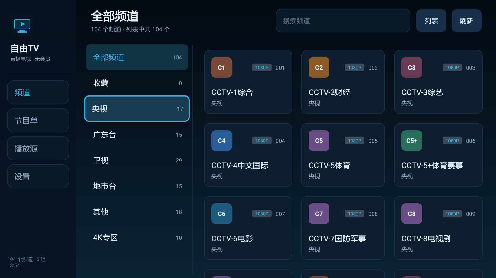
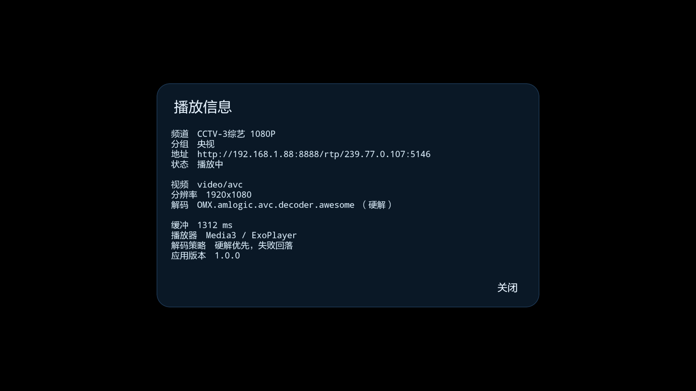

# Bolt IPTV

**Bolt IPTV - 闪电流转，秒速畅播**

Bolt IPTV 提供低延迟 IPTV 流媒体能力，实现音视频一体化局域网影音体验，织调流光，秒速畅播。

这是一款面向电视与投影的原生 Android 直播电视播放器，基于 Kotlin + Media3(ExoPlayer) 自研，不依赖 Google 服务，可直接侧载到 Android TV / 投影仪 / 机顶盒。

<p>
  
  
  
</p>



## 特性

- **双播放器预热换台**：当前频道播放时，第二个播放器在后台静音预加载下一个频道，按键时直接接管，省掉建连与等首帧的时间
- **两级频道列表**：播放页侧栏「频道分类 → 频道」，遥控器上下左右即可完成选台
- **完整遥控器交互**：方向键、确认、返回、数字键全部可用；数字键直接输入台号换台
- **节目单**：频道时间轴 + 当前节目进度，支持多天
- **多种加源方式**：订阅地址、手机扫码上传（局域网页面，支持 m3u / txt）、本地文件导入
- **播放控制**：画面比例、音轨选择、播放信息、收藏、刷新
- **MP2 音频软解**：补齐系统缺失的 MPEG-1/2 Layer II 解码，避免 IPTV 常见源「有画面没声音」
- **稳定性**：断流自动重试、错误提示、无可用源时的操作引导
- **界面细节**：240ms 缓动滑动的导航光标、全站统一 16dp 圆角、卡片的毛玻璃与封面预览

## 截图

| 播放信息条 | 播放页 |
| --- | --- |
|  |  |

## 换台为什么快

1. **预热接管**：主播放器稳定播放后，后台备机用较小的缓冲目标把下一个频道准备到「含关键帧」即可；按上下键时如果命中预热，直接把备机提升为主机，旧实例留作下一轮备机，避免反复创建开销。
2. **缓冲策略分离**：主播放器 800ms 起播 / 25s 上限，优先起播耗时；备机 6s / 10s，避免抢带宽与 CPU。
3. **媒体源直连**：`.m3u8` 走 HLS，其余走 Progressive；HTTP 连接 10s / 读取 20s，支持 Referer、UA、跨协议重定向。
4. **音频兜底**：系统缺少 MP2 解码时由 JLayer 扩展渲染器接管，其他格式仍走系统硬解。
5. **观感不黑屏**：换台保留上一帧，信息条亮 3 秒；断流自动重试两次。

## 界面设计

- 导航光标：`ValueAnimator` 240ms + `DecelerateInterpolator`，同时插值 x 与宽度，光标平滑滑动并联动切页
- 圆角：全站 16dp，自绘 `ViewOutlineProvider` 显式裁切（背景为 GradientDrawable 时 `clipToOutline` 不生效）
- 布局：自适应 1920×1080 的横屏电视，卡片尺寸按屏幕宽度计算，支持手机横屏

## 构建

环境要求：JDK 17、Android SDK 34。

```bash
# 1. 指向本机 SDK
echo "sdk.dir=$HOME/Library/Android/sdk" > local.properties

# 2. 编译 Debug
./gradlew assembleDebug
# 产物：app/build/outputs/apk/debug/app-debug.apk

# 3. 编译 Release（未配置签名时生成未签名包，绝不使用 debug key）
./gradlew assembleRelease
```

正式发布时在项目根目录创建已被 Git 忽略的 `keystore.properties`：

```properties
storeFile=/absolute/path/to/release.keystore
storePassword=你的密钥库密码
keyAlias=你的密钥别名
keyPassword=你的密钥密码
```

也可以使用 `BOLT_STORE_FILE`、`BOLT_STORE_PASSWORD`、`BOLT_KEY_ALIAS`、`BOLT_KEY_PASSWORD` 环境变量。未配置时 Release 输出 `app-release-unsigned.apk`，不会回退到公开的 debug 签名。

安装到电视：

```bash
adb connect <电视IP>:5555
adb install -r app/build/outputs/apk/debug/app-debug.apk
```

## 添加播放源

1. 打开「设置 → 管理播放源」
2. 三种方式任选：
   - **订阅地址**：填入 m3u/m3u8 链接
   - **扫码上传**：手机连同一 Wi-Fi，扫描电视上的二维码，在网页里粘贴地址或选择 m3u/txt 文件
   - **本地文件**：从设备中选择文件导入
3. 回到首页刷新即可

## 项目结构

```
app/src/main/java/io/opentv/live/
├── App.kt                    应用入口与依赖容器
├── data/
│   ├── ChannelRepository.kt  频道与播放源管理
│   ├── EpgRepository.kt      节目单解析与缓存
│   ├── M3uParser.kt          m3u / txt 列表解析
│   ├── Models.kt             数据模型
│   ├── Prefs.kt              本地设置
│   └── SourceWebServer.kt    局域网配源 HTTP 服务
├── player/
│   └── Mp2AudioRenderer.kt   MPEG Layer I/II 音频渲染器
└── ui/
    ├── MainActivity.kt       主界面与顶部导航光标
    ├── ChannelListView.kt    频道列表
    ├── ChannelAdapter.kt     频道卡片
    ├── PlayerActivity.kt     播放页、信息条、侧栏选台
    ├── EpgView.kt            节目表
    ├── SettingsView.kt       设置页
    ├── SourcesView.kt        播放源管理
    ├── PreviewCapturer.kt    频道预览抽帧
    ├── QrCode.kt             二维码生成
    └── Ui.kt                 通用 UI 工具（圆角、芯片、按钮）
```

## 已知限制

- 暂不支持 RTSP / 原生组播地址，请用 udpxy 转成 HTTP 单播后再添加
- 预览封面依赖起播抽帧，弱网下首屏可能显示占位
- 仅针对横屏电视优化，竖屏手机体验未做适配
- 未做多语言，目前仅中文界面

## 第三方依赖

| 依赖 | 协议 |
| --- | --- |
| AndroidX（core-ktx / appcompat / recyclerview） | Apache-2.0 |
| Media3 / ExoPlayer | Apache-2.0 |
| kotlinx-coroutines | Apache-2.0 |
| ZXing core | Apache-2.0 |
| JLayer（com.googlecode.soundlibs） | LGPL-2.1 |

JLayer 以依赖形式引入，仅用于补齐系统缺失的 MP2 解码；其源码可从 [JavaZoom JLayer](https://github.com/umjammer/jlayer) 获取。

## 声明

- 本项目是播放器工具，**不提供、不内置任何频道源**。请自行准备合法授权的播放列表。
- 界面布局参考了 APTV 的视觉风格，但**未使用其任何代码或资源**，本项目为独立的 Android 原生实现。
- 使用本项目产生的任何内容与法律风险由使用者自行承担。

## License

[MIT](LICENSE)
